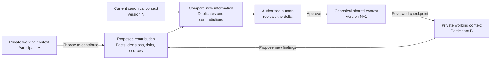
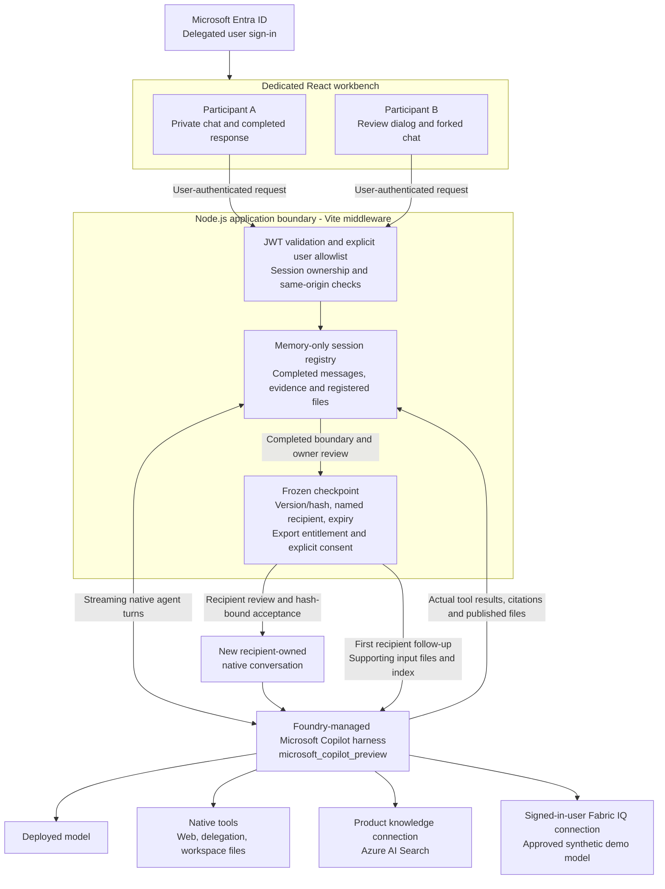
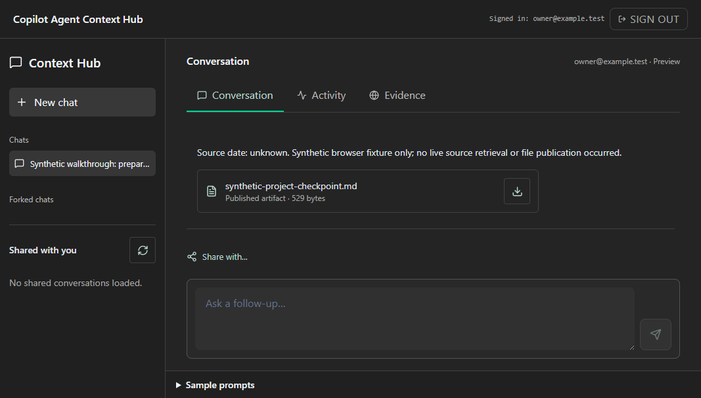
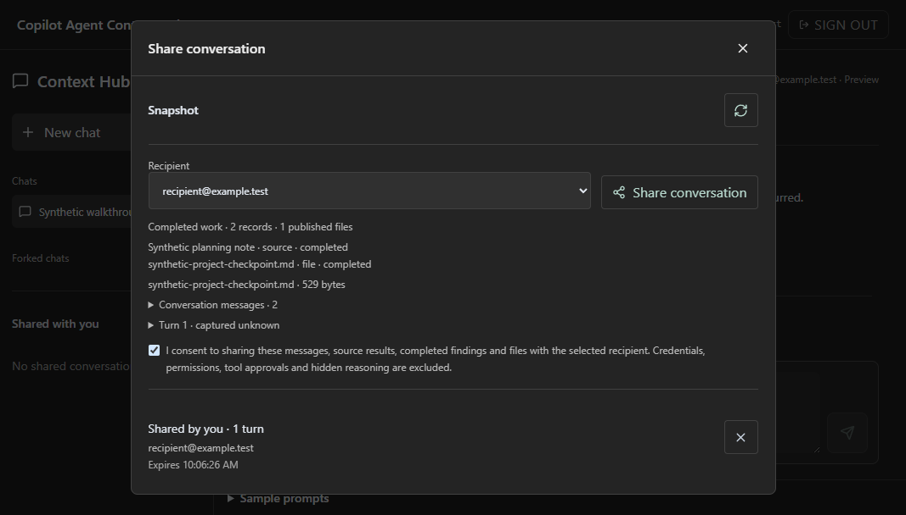
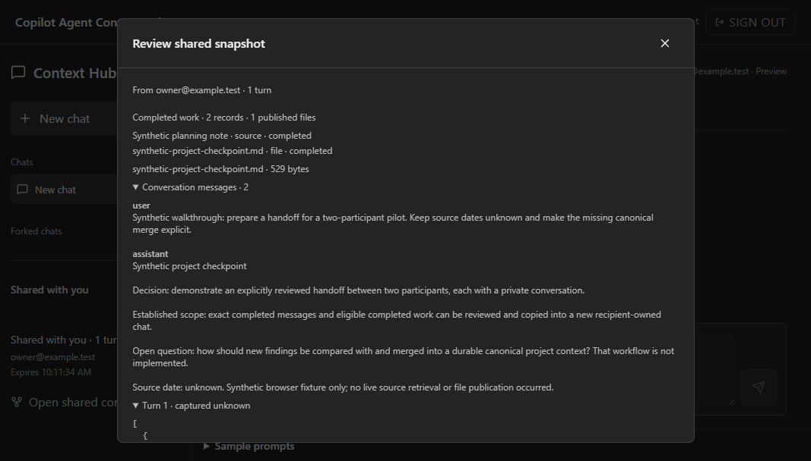
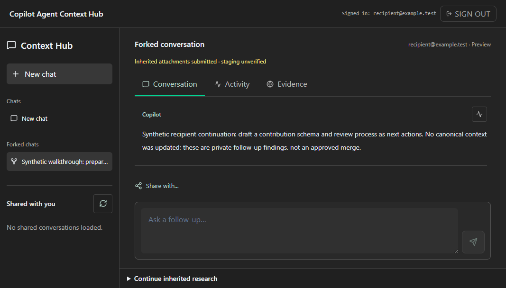

# Copilot Agent Context Hub

**A Hack-to-Build hackathon prototype for turning private agent work into an explicitly reviewed, reusable context checkpoint for another participant.**

The original submission was **Copilot Context Hub**: keep individual thinking private, propose useful contributions, and merge approved changes into a canonical shared project context. This repository explores the handoff at the heart of that idea with a working Microsoft Foundry prototype. It is not yet the complete shared-context merge system.

## The Hackathon Idea

The proposed solution separates context into three logical layers:

| Layer | Intended responsibility |
| --- | --- |
| Private working context | Each participant explores a problem in their own Microsoft 365 Copilot, Teams or dedicated agent conversation. Private work is not automatically published. |
| Proposed contributions | Copilot Studio and/or a pro-code agent extracts facts, assumptions, decisions, risks, questions, actions and source references. It compares a proposal with the current project context to surface new information, duplicates, contradictions and superseded assumptions. An authorized person reviews the delta. |
| Canonical shared project context | Accepted changes become a new version of a persistent project record, potentially backed by SharePoint, Dataverse or a Copilot Notebook/Page. Microsoft Graph references permitted Microsoft 365 content where appropriate. |

The intended governance foundation is Microsoft Entra ID, existing Microsoft 365 permissions, Purview controls, provenance, versioning and audit. These are design requirements, not a claim that every integration exists in this prototype.



*Original target architecture, not the current implementation.*

The submitted Hack-to-Build MVP was deliberately narrow: ingest a supplied Copilot conversation, create a reviewed checkpoint, let a second participant work from it, identify that participant's new findings, and merge an approved delta into a new shared-context version.

## Why This Prototype Uses Foundry

During implementation, the Microsoft 365 Copilot APIs needed for the proposed conversation/context workflow were not available to this project as usable public interfaces. Rather than simulate a Microsoft 365 integration, the prototype moved to a dedicated agent experience on Microsoft Foundry. This describes the project's implementation constraint, not a comprehensive statement about current Microsoft 365 API availability.

The pivot preserves the central interaction: **work privately, choose a completed boundary, review exactly what will be shared, and let another participant continue independently.** It uses the Foundry-managed Microsoft Copilot harness (`microsoft_copilot_preview`), not an application-built replacement or a model-only Responses fallback. This does not connect to, export from, or clone a user's Microsoft 365 Copilot conversation.

| Original ambition | What this repository implements |
| --- | --- |
| Microsoft 365 Copilot or Teams entry point | Dedicated React workbench with Entra sign-in. No Microsoft 365 conversation ingestion. |
| Private working context | Independently owned native agent conversations, with application ownership checks. Provider-level per-conversation confidentiality is not certified. |
| Reviewed context checkpoint | Exact completed questions/replies plus an immutable package of eligible completed work, explicit owner consent and named recipient. |
| Second participant works from a checkpoint | Recipient reviews the frozen package and accepts it into a separate native conversation. Later turns remain independent. |
| Structured fact/decision/risk extraction and delta comparison | Not implemented. Captured completed work is not a normalized project fact store or semantic diff. |
| Merge an approved delta into canonical version N+1 | Not implemented. Snapshot versions/hashes bind consent; they are not canonical project versions. |
| Persistent SharePoint/Dataverse/Notebook/Page record, Graph and Purview integration | Future work. Current application session/share state is memory-only; no durable shared context, audit ledger or Purview integration is implemented. |

## Implemented Architecture



The application owns authentication, streaming, session ownership, checkpoint capture, consent and authorized downloads. The managed harness owns native research, delegation, tool execution and its workspace. There is no application-controlled source fan-out or credentialed fallback when a native source fails.

The dedicated Azure deployment has a separate resource group, Foundry account/project/model, Basic Search, Log Analytics and Application Insights. Foundry is in `westus`; Search is in `westus2`. The Fabric source is an explicitly approved read-only dependency through a signed-in-user connection over synthetic demo data, not live CRM. Infrastructure is declared in [infra/main.bicep](infra/main.bicep); the harness definition is [harness/azure.yaml](harness/azure.yaml).

## How The Handoff Works

1. **Work privately.** Participant A asks the agent a research question. Conversation, Activity and Evidence views distinguish displayed text from actual returned tool evidence. Sample prompts sit alongside the transcript; verified downloadable files appear with their response.
2. **Choose a completed checkpoint.** Share with... opens a modal for the latest completed conversation boundary. The owner reviews completed work and omissions, selects a named recipient and explicitly consents. This is not an arbitrary earlier-turn selector.
3. **Freeze the package.** The server captures exact submitted questions and displayed completed assistant text without summary or truncation, plus eligible returned source content, citations, exposed completed task findings, Markdown readbacks and verified published Markdown bytes. The share is recipient-bound, revocable before acceptance and expires within 30 minutes.
4. **Review before accepting.** Participant B opens the invitation. The snapshot loads immediately with messages and completed work expanded. Acceptance requires explicit consent to that package's hash, not merely possession of an identifier.
5. **Continue independently.** Acceptance creates a new recipient-owned native conversation under Forked chats. The owner's chat is not overwritten. The first recipient question submits supporting files and an index through native `input_file` attachments. Later successful turns do not resend the package.

Imported work is historical material, not proof of fresh retrieval or a transfer of tool execution. Native attachment staging is best effort; successful index-read evidence does not establish that every file was staged or used. New findings are currently part of the recipient's conversation: automatic extraction, reconciliation and merge-back remain outside the implementation.

## Illustrated Walkthrough

**Captured on 2026-11-16 from the actual React workbench using synthetic browser-local identities, API responses and streamed output.** These screenshots demonstrate the interface and consent flow, not a new authenticated Foundry run. The `example.test` participants, source record, file and assistant replies are fixtures. Even the displayed "Published artifact" entry is simulated; no file was published to Azure during this test. Unknown source/capture dates remain unknown.

### 1. Complete Work Privately

The owner completes a synthetic planning question. The bottom of the response keeps its file control and Share with... action together, rather than moving files into a global header.



### 2. Review And Name A Recipient

The owner selects `recipient@example.test`, reviews the completed-work inventory and consents. The browser test verified that Share conversation was disabled without consent and that submission carried the chosen recipient, `consent_completed_work: true` and snapshot `context_version: 1`.



### 3. Inspect The Frozen Snapshot

The recipient opens Shared with you. Exact messages and completed-work details are expanded immediately; the recipient can scroll through the package before consenting. The test checked the full assistant text, both expanded sections, disabled acceptance before consent, and submission of the reviewed `context_hash` with `accept_completed_work: true`.



### 4. Continue In A Separate Fork

Acceptance adds a Forked chat without deleting the recipient's existing chat. The test verified exact inherited questions/replies, the inherited-file label and a follow-up request using the distinct synthetic recipient session. The response proposes next actions; it does not pretend to merge them into canonical project context. The visible "staging unverified" status is deliberately not a claim that the harness read supporting files.



## Key Implementation Decisions

| Decision | Why it matters |
| --- | --- |
| Preserve the managed Copilot harness | Retains native research, delegation, conversations and workspace capabilities without rebuilding them as custom orchestration. The Node application remains the collaboration boundary. |
| Copy exact messages, not an AI summary | Makes the reviewed boundary inspectable and avoids introducing summary omissions or invented conclusions. This is application-controlled import, not a native full-harness clone. |
| Add one frozen completed-work package | Reuses eligible returned evidence and actual published Markdown, rather than relying on a prose answer alone. Source dates, unknown dates, provenance and synthetic-data disclosures are preserved. |
| Bind consent to recipient, version and hash | Owner consent binds the chosen recipient and current snapshot version. Recipient consent binds the exact frozen hash. Later private turns cannot silently alter an invitation. |
| Separate chat access from source export | `HARNESS_CONTEXT_EXPORT_OBJECT_IDS` attests separately reviewed recipient entitlement. It is not source-ACL discovery, an Azure permission grant, or a substitute for review. |
| Fail closed instead of silently degrading | Protected/oversized packages block sharing rather than falling back to text-only or truncating. Unsupported material is explicit. Credential-pattern detection is conservative, not exhaustive DLP. |
| Give each participant a new native conversation | Supports independent later work without copying credentials, permissions, tool approvals, hidden reasoning or native execution history. Provider IDs alone never authorize access. |
| Keep persistence out of this proof of concept | In-memory session/share state keeps the handoff narrow, but refresh/sign-out/restart loses local mappings; idle backend sessions expire after 30 minutes. It is not durable project memory. |
| Show evidence rather than infer success | Only actual provider/tool results establish source execution or publication. The animated filling bar is a pending-request indicator, not measured completion or backend-health evidence. |

Application limits are 256 KiB for the transcript, 1 MiB per captured record/published Markdown file, 4 MiB of records per completed turn, 8 MiB per session/package, 128 attachments including the index, and a 12 MiB encoded attachment request. Published UTF-8 Markdown retains exact bytes, including BOMs, under new recipient-authorized download IDs. See [PROJECT_SETUP.md](PROJECT_SETUP.md) for configuration and operational details.

## Validation And Evidence

A separately approved live four-turn exact-message fork proof passed on **2026-11-14**. It observed exact shared-message inheritance into a distinct recipient-owned native conversation, owner continuity/recall, and private-marker exclusion in both directions. That result does **not** validate the later enriched attachment staging, all source routing, provider-level confidentiality, token savings or production readiness.

The following checks were rerun on **2026-11-16** for this write-up:

| Check | Observed outcome | Evidence boundary |
| --- | --- | --- |
| `npm test` | 70 passed, 0 failed, 2 live tests skipped | Offline backend/client/data tests, including ownership, consent, frozen packages, limits, revocation and exact published bytes. No live inference. |
| `npm run lint` | 0 warnings, 0 errors | Local lint gate. |
| `npm run build` | Passed | Existing nonfatal bundle-size advisory: 514.29 kB JavaScript chunk. |
| Synthetic browser walkthrough | Passed the consent, payload, exact-text, fork and follow-up checks described above | Real UI with mocked authentication/API/SSE on an isolated frontend-only server. Not real Entra authorization or end-to-end Foundry execution. |

The active demo and its sessions were not restarted or refreshed; no assistant-paid inference, source query, cloud change or export-policy change was performed. Full outcomes, preceding failures and limitations are retained in [docs/runtime-validation-report.md](docs/runtime-validation-report.md).

## Run It

This is a Node.js ESM/React application; no Python application runtime is required.

```bash
npm install
# Configure your own reviewed environment using .env.example and PROJECT_SETUP.md.
npm run dev
```

Open http://127.0.0.1:5184/ and use separate browser profiles for the two participants. Sign in, complete a question as the owner, share with the reviewed recipient, then review and accept from the recipient profile. Do not restart or refresh an active demo without coordinating: local session/share/download mappings are ephemeral.

Configuration and deployment are environment-specific. The existing local demo enables source export only for the separately reviewed recipient; ignored configuration is not shipped with this repository. Other deployments need their own identity, source-entitlement and resource review. Deployment does not authorize paid inference. Model, retrieval, Search and logging charges apply; the manual-testing configuration has no application-enforced token or spending cap. Assistant-driven paid tests need separate finite approval. No measured latency, cost or token-saving claim is made.

```bash
npm test
npm run lint
npm run build
```

Default tests are offline; live tests are opt-in. Unsupported harness controls such as `tool_choice` and `max_output_tokens` are rejected locally rather than silently forwarded. Earlier stopped test allowances and service failures remain documented in the validation report, not erased by later successes. Use direct CLI commands for approved Azure operations; local credentials, receipts and deployment state stay ignored.

## Next Toward The Original MVP

The next step is a **proposal-and-merge workflow**, not merely more chat sharing: define a structured contribution schema, compare new findings against a durable canonical project version, show duplicates/contradictions/superseded assumptions, and let an authorized reviewer approve a versioned delta. A production design would also need a reviewed persistence choice, permitted Microsoft 365 references, durable audit and provenance, retention/erasure controls, concurrency handling and the relevant Purview integration. None should be inferred from this checkpoint-and-fork prototype.